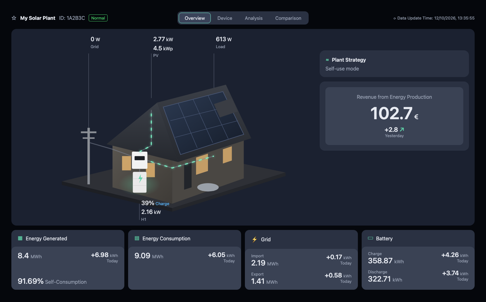
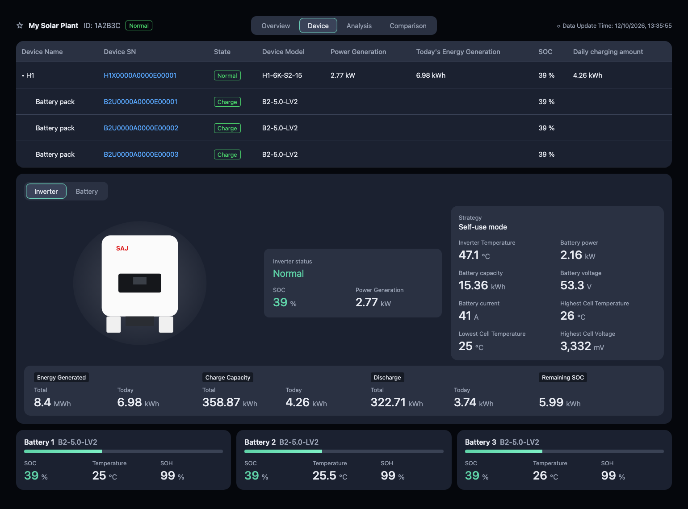
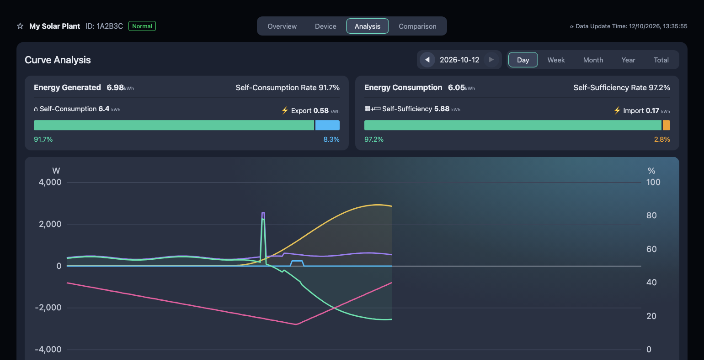
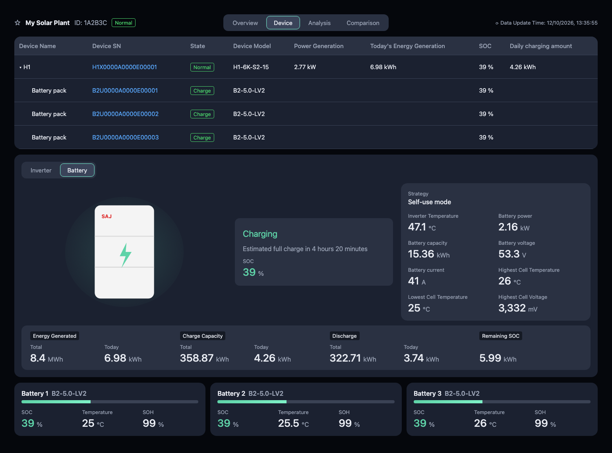
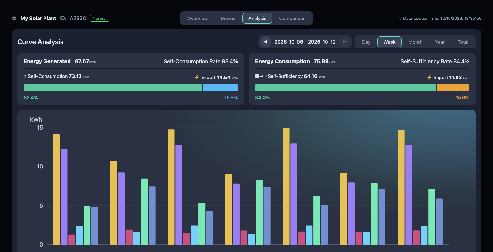
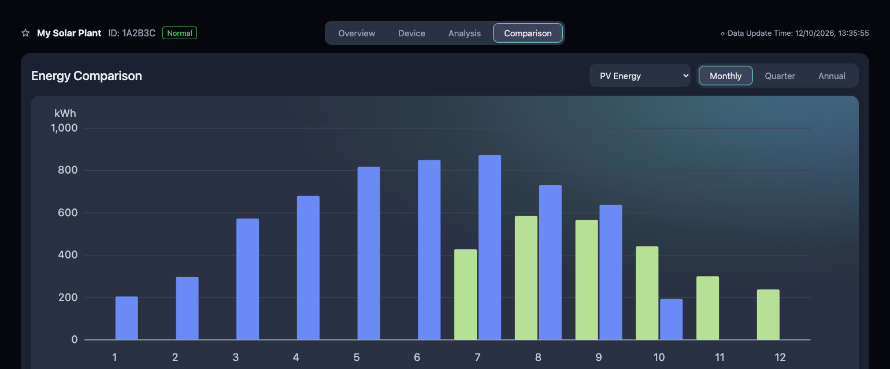
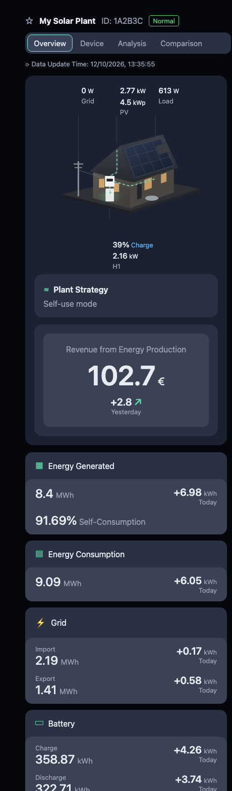

# SAJ Elekeeper Card

[](https://github.com/hacs/integration)
[](https://github.com/dmdias/saj-elekeeper-card/releases)
[](https://github.com/dmdias/saj-elekeeper-card/actions/workflows/validate.yml)
[](LICENSE)

A Home Assistant dashboard card that recreates the **SAJ Elekeeper** portal
for SAJ solar inverters and batteries: the house energy flow, the device
panels and the energy charts, inside your own Home Assistant.

It reads its data from the [SAJ eSolar Cloud](https://github.com/dmdias/ha-saj-esolar-cloud)
integration. It needs no other frontend cards: the charts are drawn by the
card itself from the Home Assistant history and statistics.



## Contents

- [Features](#features)
- [Requirements](#requirements)
- [Installation](#installation)
  - [HACS (recommended)](#hacs-recommended)
  - [Manual](#manual)
- [Adding the card](#adding-the-card)
- [Configuration](#configuration)
- [Views](#views)
- [Sensors used](#sensors-used)
- [History and statistics](#history-and-statistics)
- [Updating](#updating)
- [Troubleshooting](#troubleshooting)
- [Development](#development)
- [License](#license)

## Features

- **Overview**: animated energy flow between grid, solar panels, battery and
  house, with live power values. Also the plant strategy (operating mode),
  revenue, and energy generated / consumption / grid / battery totals with
  today's values.
- **Device**: inverter and battery packs table, an inverter / battery detail
  panel, and a card per battery pack. The detail panel shows status, SOC,
  temperatures, cell readings, remaining energy and estimated time to full
  charge.
- **Analysis**: today's power curves (PV, load, grid, battery, SOC) and
  energy bars by week, month, year or in total. Each period has its
  self-consumption and self-sufficiency summary.
- **Comparison**: any energy counter per month, quarter or year, comparing
  years side by side.
- Finds the integration's sensors on its own, so there are no entity IDs to
  configure.
- Dark theme matching the portal, with layouts for desktop, tablet and phone.

| Device | Analysis |
|---|---|
|  |  |
|  |  |

| Comparison | Phone |
|---|---|
|  |  |

## Requirements

- Home Assistant 2024.1 or newer.
- The [SAJ eSolar Cloud](https://github.com/dmdias/ha-saj-esolar-cloud)
  integration, version 1.1.0 or newer, set up with at least one plant.

  The card also works with the [original integration](https://github.com/elboletaire/ha-saj-esolar-cloud).
  That integration has no sensors for inverter temperature, battery cells,
  remaining energy, time to full, self-sufficiency, battery totals or
  revenue, so those values show as `--`.

## Installation

### HACS (recommended)

The card is not in the default HACS store yet. Add this repository to HACS
as a custom repository:

[](https://my.home-assistant.io/redirect/hacs_repository/?owner=dmdias&repository=saj-elekeeper-card&category=plugin)

Or by hand:

1. Open **HACS** in Home Assistant.
2. Open the **⋮** menu (top right) and choose **Custom repositories**.
3. Enter `https://github.com/dmdias/saj-elekeeper-card`, choose the type
   **Dashboard**, and click **Add**.
4. Search for **SAJ Elekeeper Card**, open it and click **Download**.
5. Reload the browser when HACS asks you to.

HACS registers the card as a dashboard resource for you. You can go
straight to [Adding the card](#adding-the-card).

### Manual

1. Download `saj-elekeeper-card.js` from the
   [latest release](https://github.com/dmdias/saj-elekeeper-card/releases/latest).
2. Copy it to `/config/www/saj-elekeeper-card.js` in Home Assistant, for
   example with the *File editor* or *Samba* add-on. You can also run this in
   the *Terminal & SSH* add-on:

   ```bash
   wget -O /config/www/saj-elekeeper-card.js \
     https://github.com/dmdias/saj-elekeeper-card/releases/latest/download/saj-elekeeper-card.js
   ```

3. Register it as a resource: **Settings → Dashboards → ⋮ → Resources →
   Add resource**.
   - URL: `/local/saj-elekeeper-card.js?v=1.1.0`
   - Resource type: **JavaScript module**

   If you do not see *Resources*, turn on **Advanced mode** in your user
   profile.
4. Reload the browser.

## Adding the card

### A dedicated dashboard (recommended)

The card is designed to fill a whole page, like the portal.

1. **Settings → Dashboards → Add dashboard → New dashboard from scratch**,
   name it, for example, *Solar*.
2. Open the new dashboard, then **✏️ (Edit) → ⋮ → Raw configuration editor**.
3. Paste:

   ```yaml
   views:
     - title: Solar
       path: solar
       icon: mdi:solar-power-variant
       type: panel
       cards:
         - type: custom:saj-elekeeper-card
           pv_capacity: 4.5
   ```

4. Save.

`type: panel` makes the card use the full width of the page.

### In an existing dashboard

Edit the dashboard, **Add card → Manual**, and enter:

```yaml
type: custom:saj-elekeeper-card
```

The card also appears as **SAJ Elekeeper** in the card picker. To show a
single part of the portal, set `view` (see [Configuration](#configuration)):

```yaml
type: custom:saj-elekeeper-card
view: overview
```

## Configuration

| Option        | Type   | Default     | Description |
|---------------|--------|-------------|-------------|
| `view`        | string | `all`       | `all` shows every view with tabs. `overview`, `device`, `analysis` or `comparison` shows only that view, without tabs. |
| `plant_uid`   | string | first plant | The plant to show, when the integration monitors several. This is the plant ID shown in the card header. |
| `pv_capacity` | number | –           | Installed solar capacity in kWp, shown under the PV power on the overview. |
| `weather`     | string | –           | A `weather.*` entity whose temperature is shown on the overview. |
| `title`       | string | plant name  | Replaces the plant name in the header. |

### Examples

Everything, with the PV capacity and the outside temperature:

```yaml
type: custom:saj-elekeeper-card
pv_capacity: 4.5
weather: weather.forecast_home
```

Two plants, each on its own dashboard view:

```yaml
views:
  - title: House
    type: panel
    cards:
      - type: custom:saj-elekeeper-card
        plant_uid: 1A2B3C4D5E6F
        title: House
  - title: Garage
    type: panel
    cards:
      - type: custom:saj-elekeeper-card
        plant_uid: 6F5E4D3C2B1A
        title: Garage
```

The overview and the charts side by side, as separate cards:

```yaml
type: grid
columns: 1
cards:
  - type: custom:saj-elekeeper-card
    view: overview
  - type: custom:saj-elekeeper-card
    view: analysis
```

## Views

### Overview

- **Energy flow**: power from or to the grid, solar production (with
  `pv_capacity`), house load, and battery SOC, state and power. The moving
  lines show where energy is flowing; a line stays still when its power is
  under 5 W.
- **Plant Strategy**: the inverter operating mode, for example *Self-use
  mode*.
- **Revenue from Energy Production**: total revenue, plus yesterday's
  revenue (or today's, when that is what the API reports). The panel is
  hidden when the SAJ account reports no revenue.
- **Energy cards**: lifetime totals with today's values. Energy Generated
  also shows today's self-consumption rate.

### Device

- **Device table**: the inverter (serial number, state, model, power,
  today's energy, SOC, today's charge) and each battery pack (serial number,
  state, model, SOC).
- **Inverter / Battery panel**:
  - *Inverter*: inverter status, SOC and PV power.
  - *Battery*: charging state, estimated time to full charge, and SOC.
  - Both show the strategy, inverter temperature, battery power, capacity,
    voltage and current, and the highest / lowest cell temperature and
    highest cell voltage.
  - When the battery reports no highest cell voltage, the panel shows the
    average cell voltage instead.
  - Along the bottom: totals and today's values for generation, charge and
    discharge, and the energy left in the battery.
- **Battery packs**: SOC, temperature and health (SOH) of each pack.

### Analysis

- **Day**: PV, load, grid and battery power (W) and battery SOC (%) over
  the day, from the Home Assistant history. Hover the chart to read the
  values at a given time.
- **Week / Month / Year / Total**: PV energy, load consumption, grid import
  and export, and battery charge and discharge per day, month or year, from
  the long-term statistics.
- **Summary bars**:
  - *Self-consumption*: the share of generated energy used on site rather
    than exported.
  - *Self-sufficiency*: the share of consumption not bought from the grid.

Use ◀ ▶ to move between days, weeks, months or years.

### Comparison

Pick an energy counter (PV energy, load consumption, import, export, charge
or discharge). It is shown per month, quarter or year, with one colour per
year, for up to the last five years.

## Sensors used

The card finds the integration's sensors through the entity registry, using
their unique IDs, so renaming entities does not break it.

| Sensor (as named by the integration) | Used for |
|---|---|
| PV Power, Grid Power, Battery Power, Total Load Power | Energy flow, day curves |
| Battery Level, Battery Direction | Energy flow, SOC, charging state, day curves |
| Operating Mode | Plant strategy |
| Total / Today Generation, Self-Use Rate | Energy Generated card |
| Total Consumption, Today Consumption | Energy Consumption card |
| Total / Today Grid Import, Total / Today Grid Export | Grid card |
| Total Battery Charge / Discharge, Today Battery Charge / Discharge | Battery card |
| Total, Today and Yesterday Revenue | Revenue panel |
| Inverter Status, Device Online, Last Update | Header, device table, inverter panel |
| Inverter Temperature, Battery Capacity, Battery Voltage, Battery Current | Detail panel |
| Battery Highest / Lowest Cell Temperature, Highest / Average Cell Voltage | Detail panel |
| Battery Remaining Energy, Battery Time To Full | Detail panel |
| Battery *N* Level, Temperature, Health, Status, Model | Battery packs |

The bar charts and the comparison use the long-term statistics of the
*Total Generation*, *Total Consumption*, *Total Grid Import*, *Total Grid
Export*, *Total Battery Charge* and *Total Battery Discharge* sensors.

## History and statistics

The charts only show what Home Assistant has recorded. Data from before
you installed the integration, or from before a sensor existed, is not
fetched from the SAJ cloud.

- **Day view**: uses the state history. Home Assistant deletes it after
  the number of days set in the recorder (`purge_keep_days`, 10 by default).
  To look back further than that, keep more days:

  ```yaml
  recorder:
    purge_keep_days: 30
  ```

- **Week, month, year, total and comparison**: use the long-term statistics.
  These are never deleted, so the views fill in as months go by. They begin
  on the day each energy sensor was first recorded.

## Updating

- **HACS**: when a new version is out, HACS shows an update. Click
  **Update** and reload the browser.
- **Manual**: download the new file again, and change the `?v=` part of
  the resource URL to the new version. This is needed because Home Assistant
  tells browsers to keep files from `/local` for a month; without a new URL
  they keep using the old card.

See the [changelog](CHANGELOG.md) for what changed in each version.

## Troubleshooting

**"Custom element doesn't exist: saj-elekeeper-card"**
The resource is not loaded. Check that it is listed under **Settings →
Dashboards → ⋮ → Resources**, then reload the browser. On the companion app:
**Settings → Companion app → Debugging → Reset frontend cache**.

**"No SAJ eSolar Cloud sensors found"**
The integration is not set up, or all its sensors are disabled. The card
looks for sensors of the `saj_esolar_cloud` integration; check **Settings →
Devices & services**.

**The card shows `--` for some values**
That sensor has no value. Check it in **Settings → Entities**.
- If the sensor does not exist, use the integration listed in
  [Requirements](#requirements).
- If it is *unknown*, your SAJ account does not report that value. For
  example, cell readings and revenue are only available on some inverters
  and accounts.

**A change does not show up after updating**
Your browser is still using the old file. Update through HACS, or change the
`?v=` of the resource. Then reload with the cache cleared (Ctrl/Cmd + Shift
+ R).

**The charts say "Loading…" forever or show an error**
The card reads history and statistics through the recorder. Check that the
`recorder` integration is running and look at **Settings → System → Logs**.

**An old inverter shows up in the device table**
The card skips devices whose sensors are all unavailable, such as a
replaced inverter. If one still shows up, delete its old entities in
**Settings → Entities**.

## Development

The card is a single dependency-free file, `dist/saj-elekeeper-card.js`.

`preview/index.html` runs the card against a mocked Home Assistant (states,
entity registry, history and statistics). Open it in a browser to work on
the card without a Home Assistant instance:

```
preview/index.html?tab=overview            # overview | device | analysis | comparison
preview/index.html?tab=analysis&mode=week  # day | week | month | year | total
preview/index.html?tab=device&detail=battery
preview/index.html?norevenue=1             # an account without revenue
preview/index.html?width=420               # phone layout
```

To release a new version:

1. Update `CARD_VERSION` in `dist/saj-elekeeper-card.js` and the
   [changelog](CHANGELOG.md).
2. Create a GitHub release tagged `vX.Y.Z` with the same version. The release
   workflow checks the version and attaches the card file, and HACS offers
   the update.

## License

[GPL-3.0](LICENSE), like the SAJ eSolar Cloud integration it builds on.

This project is not affiliated with SAJ Electric. "SAJ" and "Elekeeper" are
trademarks of their owners.
